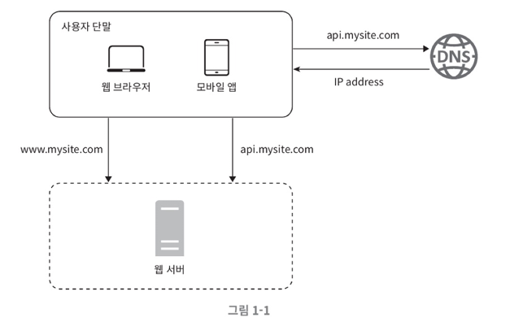
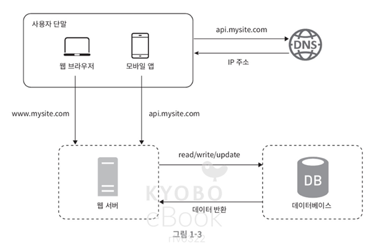
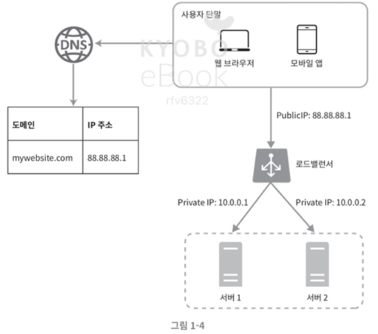
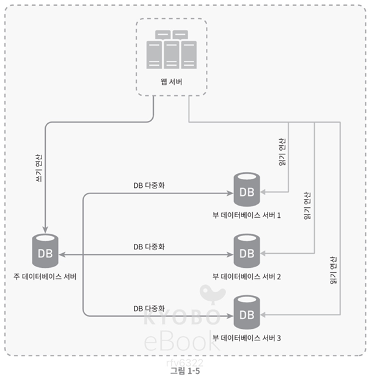
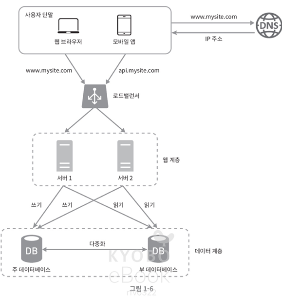
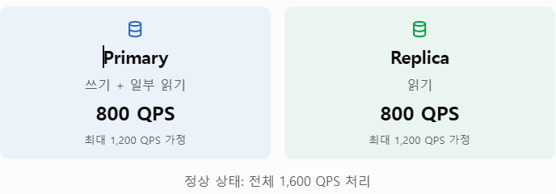
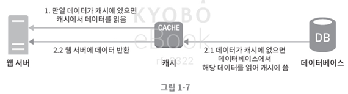

# 사용자 수에 따른 규모 확장성

## **1. 단일 서버 설계**

복잡한 시스템을 만들려면 단일 서버 먼저 설계해보아야 한다. 아래와 같이 구성되어있다고 생각해보자. 이때 한 서버에 웹앱, 데이터베이스, 캐시 등이 모두 들어있다고 가정한다.

위 그림에서 사용자 요청 처리 흐름을 살펴보면 다음과 같다.

**1. 사용자가 요청한 도메인 이름을 IP 주소로 변환**

사용자는 도메인 이름을 이용해 사이트에 접속한다. 접속을 위해서는 **도메인 이름을 DNS에 질의해 IP 주소로 변환**하는 과정이 필요하다. (DNS는 보통 유료서비스를 이용)

**2. 해당 IP 주소로 HTTP요청 전달**

**3. 요청을 받은 웹서버는 HTML 페이지나 JSON 형태의 응답 반환**

그럼 실제 요청은 어디로부터 올까? 보통은 두 종류의 단말(웹앱, 모바일앱)에서 온다.

 

## **2. 데이터베이스**

사용자가 늘어나면 서버 하나로는 힘들기 때문에, 여러 서버를 두게 되는데 하나는 웹/모바일 트래픽 처리 용도이고 **다른 하나는 데이터베이스**용이다. 이렇게 분리해두면 각각을 독립적으로 확장할 수 있다.

### **어떤 데이터베이스를 사용해야할까?**

데이터베이스를 선택할 때는 크게 두 가지를 고려해야 한다.

#### **관계형 DB**

관계형 DB는 RDBMS라고도 한다. 가장 유명한 것으로는 **MySQL, 오라클DB, PostgreSQL**이 있다.

RDB는 자료를 테이블과 열로 표현하며, 여러 테이블에 있는 **데이터를 관계에 따라 JOIN하여 합칠 수** 있다.

#### **비관계형 DB**

비관계형 DB는 NoSQL이라고도 한다. 가장 유명한 것으로는 **MongoDB, Redis, Cassandra**가 있다.

이는 **다시 키-값 저장소, 그래프저장소, 칼럼 저장소, 문서 저장소**로 나눌 수 있으며, 이들은 일반적으로 **JOIN 연산을 지원하지 않는다.**

 

보통의 경우 관계형 데이터베이스를 사용하겠지만, 구축하려는 시스템에 따라 이외 저장소도 고려해야 한다. 아래와 같은 경우에는 NoSQL이 바람직한 선택일 수 있다.

- **아주 낮은 응답 지연시간**이 요구되는 경우
  - NoSQL은 기본적으로 정규화를 요구하지 않아 **JOIN 에 드는 비용이 거의 없음**
- 다루는 데이터가 **비정형**인 경우
- 데이터를 직렬화 하거나 역직렬화 할 수 있기만 하면 되는 경우
- **아주 많은 데이터를 저장**해야 하는 경우

 

## **3. 수직적 규모 확장 vs 수평적 규모 확장**

사용자가 늘어나 현재의 상태로 운영이 힘들다고 판단되는 경우, **스케일 업(Scale up)** 과 **스케일 아웃(Scale out)** 이라는 두 가지 선택지가 있다.

### **Scale Up (수직적 규모 확장)**

수직적 규모 확장은 서버에 **고사양 자원 (좋은 CPU, 많은 RAM 등)을 추가**하는 행위를 의미한다.

비교적 단순하게 해결할 수 있어 **트래픽이 적은 경우 좋은 선택지**이지만, 한 대의 **서버에 CPU나 메모리를 무한대로 증설할 수 없다는 단점**이 있다. 또, 이 방식은 서버를 1대 사용하기 때문에, **장애에 대한 자동 복구 방안이나 다중화를 제시하지 않**는다. **서버에 장애가 날 경우 서비스가 중단**된다는 치명적인 문제가 있다.

### **Scale Out (수평적 규모 확장)**

수평적 규모 확장은 서버를 **여러 대 두어 트래픽을 분산**시켜 성능을 개선하는 행위를 의미한다.

수직적 규모 확장에서의 문제를 해결할 수 있어 대규모 애플리케이션을 지원할 때는 수평적 규모 확장법을 사용한다.

웹서버가 다운되면 사용자가 서비스를 이용할 수 없고, 너무 많은 사용자가 접속하면 응답속도가 느려지거나 서버 접속이 불가할 수 있다. 이런 문제를 해결하기 위해 **부하 분산기 혹은 로드밸런서를 도입**할 수 있다.

 

### **로드밸런서**

그림과 같이 **사용자는 로드밸런서의 pub IP 주소로 접속**하기 때문에 **웹서버가 클라이언트의 접속을 직접 처리하지 않는다.**

보안을 위해서 **서버간 동신에 private IP**가 이용된다. 로드밸런서 또한 웹서버와 통신하기 위해 private IP를 이용한다!

그림처럼 서버를 추가하고 나면 장애를 복구하지 못하는 문제가 해소되고, 가용성은 향상된다.

트래픽이 가파르게 증가하는 경우에도 **로드밸런서가 있으면 서버를 더 추가해 자동으로 트래픽을 분산**할 수 있게 하면 된다.

 

### **데이터베이스 다중화**

데이터베이스 또한 서버를 여러 대 두어 트래픽을 분산시킬 수 있다. 보통 DB 서버를 **주(master)-부(slave) 관계**를 설정해 데이터 **원본은 주 서버**에, **사본은 부 서버**에 저장하는 방식으로 다중화를 지원한다.

**쓰기연산은 마스터에서만 지원**하고, **부DB는 주DB로부터 사본을 전달받아 읽기연산만 지원**한다. 대부분의 애플리케이션은 읽기 연산의 비중이 쓰기 연산보다 훨씬 높아서 부 데이터베이스의 개수가 보통 더 많다.

#### **데이터베이스 다중화의 장점**

데이터베이스 다중화의 장점은 다음과 같다.

- **성능 향상**
  - 주-부 다중화 모델을 사용하면 **병렬로 처리될 수 있는 질의 수가 늘어나** 성능이 향상된다.
- **안정성**
  - 자연재해 등의 이유로 DB 서버 일부가 파괴되어도 데이터가 보존될 수 있다.
- **가용성**
  - 데이터를 여러 지역에 복제해두어 하나의 DB에 장애가 발생해도 **다른 서버의 데이터를 가져와 서비스**할 수 있다.

> 🔗 **처리하는 쿼리수는 DB 서버수에 비례할까?**
>
> 결론적으로는 아니다.
>
> **1. 쓰기는 여전히 한 대에서 처리**
>
> Replica를 아무리 늘려도 쓰기 작업에서 병목이 발생할 수 있다. 전체 쿼리에서 쓰기의 비중이 어느정도냐에 따라 다를 수 있다.
>
> **2. 복제 작업에도 비용이 발생**
>
> 주 서버에서 데이터가 변경되면 부 서버에도 적용해야 한다. 이로 인한 복제 전송 부담이나 네트워크 사용량이 증가할 수 있다.

 

#### **데이터베이스 서버 중 일부가 다운된다면 어떻게 될까?**

먼저 **부 서버가 다운된 경우**, 읽기 연산이 한시적으로 주 데이터베이스에 모두 전달된다. 그 이후 즉시 부 DB 서버가 생겨 대체할 것이다.

**주서버가 다운된 경우**, 부 서버가 새로운 주 서버가 되고, 새로운 부 서버가 추가될 것이다. 부 서버의 데이터가 최신 상태가 아닐 수 있기 때문에, 없는 **데이터는 복구 스크립트를 돌려 추가**해야 한다. **다중 마스터나 원형 다중화 방식을 도입**하면 이런 상황을 대처하는 데 도움이 된다.

> 🔗 **서버가 다운되면 다른 서버들도 위험하지 않을까?**
>
> 두 개의 서버에서 받을 요청을 하나의 서버에서 받는다고 가정하면, 새 서버가 뜨기도 전에 나머지 한 서버도 다운되지 않을까싶었다.
>
> 실제로 이런 일은 일어날 수 있고, 이렇게 장애가 다른 서버로 전파되는 것을 **연쇄 장애**라고 한다.
>
> 만약 아래와 같은 상황에서 부 DB가 다운되었다고 가정해보자
>
> 
>
> 모든 읽기 요청에 Primary로 간다면 용량이 초과되어 다음과 같은 상황이 생긴다.
>
> 1. Primary에 요청이 몰리면서 **CPU, 메모리, 디스크 I/O 사용량이 증가**함.
> 2. 쿼리 응답 시간이 길어지면서 **DB 커넥션이 오래 점유**됨.
> 3. 애플리케이션의 **커넥션 풀이 고갈**되고 **요청 대기열이 증가**함.
> 4. 타임아웃과 재시도 요청까지 발생하면서 부하가 더욱 커짐.
> 5. 결국 **Primary도 정상적으로 요청을 처리하지 못할 수 있음.**
>
> 그래서 실제 서비스에서는 모든 요청을 살리기 보다는 **중요한 기능을 유지하면서 시스템 전체가 다운되는 것을 방지**한다. 가장 중요한 건 일부 서버가 다운되더라도 남은 서버가 처리할 수 있도록 자원을 여유있게 운영하는 것이다.

 

### **캐시**

캐시는 **값비싼 연산 결과나 자주 참조되는 데이터를 메모리에** 두고, 관련 요청이 빨리 처리될 수 있도록 하는 저장소이다. 애플리케이션의 성능은 DB를 얼마나 자주 호출하느냐에 따라 크게 좌우되기 때문에 캐시는 그런 문제를 완화할 수 있다.

#### **캐시 계층**

**캐시 계층(cache tier)** 은 데이터가 잠시 보관되는 곳으로, DB보다 훨씬 빠르다. 캐시를 사용하면 **성능이 개선**되고 **DB 부하도 줄일** 수 있으며, 캐시 계층의 **규모도 독립적을 확장**할 수 있다.

캐시 전략은 다양하지만, 위 사진은 **읽기 주도형 캐시 전략**이라고 부른다.

1. 요청을 받은 웹서버는 캐시에 응답이 저장되어 있는지 확인
   1. 있으면 해당 데이터를 반환
   2. 없으면 데이터베이스 질의를 통해 데이터를 찾아 캐시에 저장 후 반환

> **🔗 캐시 전략**
>
> ### **1. 읽기 주도형 캐시 전략**
>
> #### **Cache Aside (Lazy Loading)**
>
> 가장 일반적인 방식으로, 캐시에서 먼저 조회 후 데이터가 없다면 DB에서 가져와 캐시에 저장하는 방식이다.
>
> 실제 요청되는 데이터만 캐싱해 **메모리를 효율적**으로 쓸 수 있다는 장점이 있지만, **캐시 만료 시 DB에 요청이 집중**될 수 있다는 단점이 있다.
>
> #### **Read Through**
>
> Cache Aside와 비슷하지만, 캐시 시스템이 DB 조회까지 책임진다는 차이가 있다.
>
> **캐시에 데이터가 없을 때 캐시 시스템이 DB에서 가져**온다. 일반적인 Redis는 DB를 자동으로 조회하지 않아 별도의 구현이 필요하다.
>
>  
>
> ### **2. 쓰기 주도형 캐시 전략**
>
> #### **Write Through**
>
> **데이터를 변경할 때 캐시와 DB에 모두 반영하는 방식**이다.
>
> 쓰기 완료 시 캐시와 DB의 데이터를 일치시키기 쉽지만, 두 저장소에 쓰는 비용이 발생하고 **한 쪽 쓰기가 실패할 경우를 처리**해야 한다.
>
> #### **Write Back**
>
> **먼저 캐시에 기록하고 나중에 비동기적으로 DB에 반영**하는 방식이다.
>
> DB 쓰기 부하를 크게 줄일 수 있으나, DB 반영 전에 캐시 데이터가 유실되면 변경사항을 잃을 수 있다는 단점이 있다.
>
> #### **Write Around**
>
> **데이터를 쓸 때 캐시를 거치지 않고 DB에 직접 기록하는 방식**이다. 캐시는 이후 읽기 요청에서 필요할 때 채운다. 만약 이미 해당 데이터가 캐시에 존재하면 오래된 값이 반환되지 않도록 캐시를 무효화 해야 한다.

 

#### **캐시 사용 시 유의할 점**

캐시 사용시 고려할 사항은 다음과 같다.

**1. 캐시을 도입하면 좋은 상황**

데이터 갱신이 자주 일어나지 않지만, 참조가 빈번하게 일어나는 경우에 좋다.

**2. 어떤 데이터를 캐시에 두어야 할까**

캐시는 휘발성 메모리에 데이터를 두므로, 영속적으로 보관한 데이터는 바람직하지 않다.

**3. 캐시에 보관된 데이터는 어떻게 만료할까**

만료 정책을 두는 것이 좋고, **너무 짧으면 DB를 너무 자주읽게** 되고, **너무 길면 원본과 차이가 날 가능성**이 높아 적절한 기간을 정해야 한다.

**4. 장애를 어떻게 대처할까**

캐시 서버를 한 대만 두면 **단일 장애 지점 (SPOF)** 이 될 수 있기 때문에, 여러 지역에 걸쳐 캐시 서버를 분산해야 한다.

 

## **4. 콘텐츠 전송 네트워크 (CDN)**
