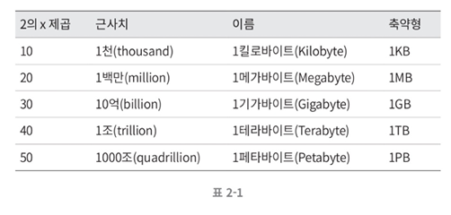
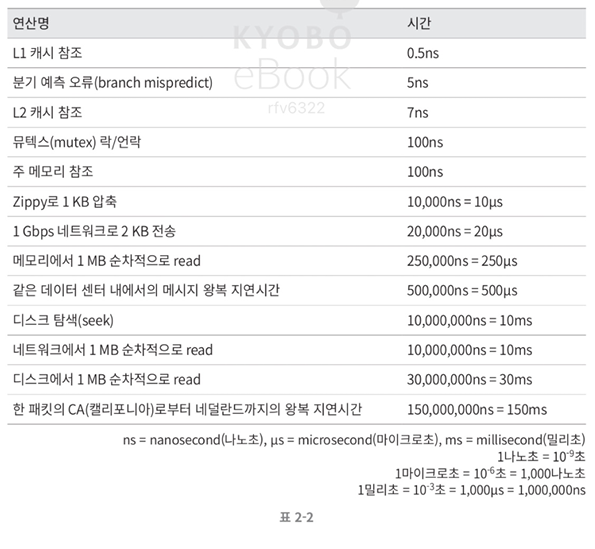
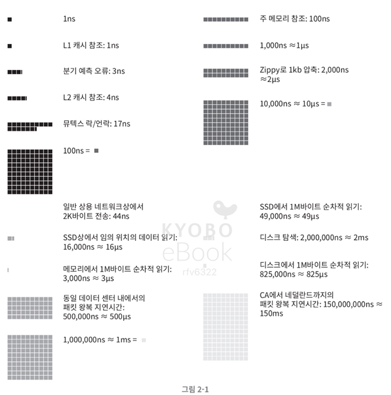
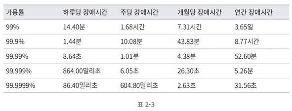

# 개략적인 규모 추정

시스템 설계 면접을 보면, 때로는 시스템 용량이나 성능 요구사항을 개략적으로 추정해보라는 요구를 받는다.

이를 효과적으로 하려면 규모 확장성을 표현하는데 필요한 것들을 알아야 한다. 하나씩 알아보자.

## **2의 제곱 수**

데이터 양을 파악하려면 제곱 수를 알아야 한다. 최소 단위는 1바이트이며, ASCII 문자 하나가 차지하는 메모리 크기가 1바이트이다.

아래 표 정도는 알아두는 게 좋다.

 

## **모든 프로그래머가 알아야 하는 응답 지연값**

아래 표는 2010년에 발표된 수치이기 때문에, 더 빠른 컴퓨터가 나오면서 유효하지 않은 수치도 있지만, 어느정도인지 짐작하는 데는 도움이 된다.

위 수치를 시각화한 그림이다.

위 수치를 보면 다음과 같은 결론을 도출할 수 있다.

**1. 메모리는 빠르지만 디스크는 아직 느리다**

**2. 디스크 탐색은 가능한 피하면 좋다**

**3. 단순한 압축 알고리즘은 빠르다**

**4. 데이터 센터는 보통 여러 지역에 분산되어있고, 센터들 간 데이터를 주고받는 데는 시간이 걸린다**

 

## **가용성에 관계된 수치들**

**고가용성**은 **시스템이 오랜시간 지속적으로 중단 없이 운영될 수 있는 능력**을 의미한다.

대부분 퍼센트로 표현하며, 100퍼센트는 한 번도 중단된 적 없는 시스템을 의미하고 보통은 99%에서 100% 사이 값을 갖는다.

**SLA (Service Level Agreement)** 는 서비스 사업자가 사용하는 용어로 고객과의 합의이다. 합의에는 서비스의 가용시간이 기술되어 있다.

아마존, 구글 등의 사업자는 99% 이상의 SLA를 제공한다.

 

## **예제 - 트위터 QPS와 저장소 요구량 추정**

#### **가정**

- 월간 능동 사용자는 3억명
- 50% 사용자가 트위터를 매일 사용
- 평균적으로 각 사용자는 매일 2건의 트윗 올림
- 미디어를 포함하는 트윗은 10% 정도
- 데이터는 5년간 보관

#### **추정**

**QPS(Query Per Seconds) 추정치**

- **일간 능동 사용자 (DAU)** = 3억 \* 50% = 1.5억
- **QPS** = 1.5억 \* 2 / 24시간 / 3600초 = 약 3500
- **최대 QPS** = 2 \* QPS = 약 7000 (100% 사용자로 가정)

**저장소 요구량 추정치**

- **평균 트윗 크기**
  - tweet_id에 64바이트
  - 텍스트에 140 바이트
  - 미디어에 1MB
- **미디어 저장소 요구량** = 1.5억 _ 2 _ 10% \* 1MB = 30TB/일
