# 처리율 제한 장치의 설계

## **처리율 제한 장치란?**

네트워크 시스템에서 **처리율 제한 장치**는 클라이언트에서 보내는 **트래픽의 처리율을 제어하기 위한 장치**이다.

HTTP로 예를 들면, 특정 기간 내에 전송되는 클라이언트의 요청 횟수를 제한한다. 요청 횟수가 임계치를 넘으면 추가로 도달한 모든 호출은 처리가 중단된다. 사용하는 상황을 예시로 확인하면 다음과 같다.

- 사용자는 초당 2회 이상 새 글을 올릴 수 없다
- 같은 IP 주소로는 하루에 10개 이상의 계정을 생성할 수 없다.
- 같은 디바이스로 주 5회 이상 리워드를 요청할 수 없다.

### **처리율 제한 장치를 두면 좋은 점**

처리율 제한 장치를 두면 좋은 점을 확인해보자.

#### **DoS 공격에 의한 자원 고갈 방지**

**DoS 공격은 서비스 거부 공격**으로, 공격자가 서버에 과도한 요청을 보내서 서버가 정상적인 요청을 처리하지 못하도록 만드는 공격이다. 처리율 제한 장치를 두면, 공격자가 **서버에 과도한 요청을 보내더라도 일정 수준 이상은 처리하지 않게 되어 서버의 자원을 보호**할 수 있다.

#### **비용 절감**

처리율 제한 장치를 두면, 서버가 **과도한 요청을 처리하지 않게 되고, 우선순위가 높은 API에 서버의 자원을 효율적으로 사용**할 수 있다.

특히 외부 API (third-party) API에 사용료를 지불하고 있는 경우, API 요청 횟수에 대해 과금이 이루어지는 경우가 많기 때문에 횟수를 제한할 수 있어야 비용을 절감할 수 있다.

#### **서버 과부하 방지**

봇에서 오는 트래픽 등으로 유발된 트래픽을 걸러낼 수 있다.

 

## **처리율 제한 장치를 설계한다면?**

3장에서 배운 4단계로 처리율 제한 장치를 구성해보자

### **1단계 - 문제 이해 및 설계 범위 확정**

처리율 제한 장치를 구현할 때에는 여러 알고리즘을 사용할 수 있고, 각각은 장단점을 갖는다.

이런 식으로 질문을 통해 방향을 잡아갈 수 있다. 이 외에도 규모 등을 물어볼 수 있을 것이다. 이 과정을 통해 아래와 같은 요구사항을 확정했다고 가정한다.

- 설정된 처리율을 초과하는 요청은 **정확히 제한**
- HTTP **응답시간에 악영향을 주지 말것**
- 가능한 **적은 메모리**를 사용할 것
- **분산형** 처리율 제한 (하나의 처리율 제한 장치를 여러 서버에서 공유)
- 요청이 제한된 경우 그 사실을 명확히 알릴 것
- 제한 장치에 장애가 생기더라도 **전체 시스템에 영향을 주지 않을 것**

### **2단계 - 개략적 설계안 제시 및 동의 구하기**

복잡하게 가져가기보다는 **client-server 통신 모델**을 사용하기로 가정한다.

> **🔗 처리율 제한 장치 모델**
>
> 책에서는 client-server 모델을 선택했는데, 다른 모델은 무엇이 있었을까?
>
> ### **서버 내부에 구현 (Server side Rate Limiting)**
>
> 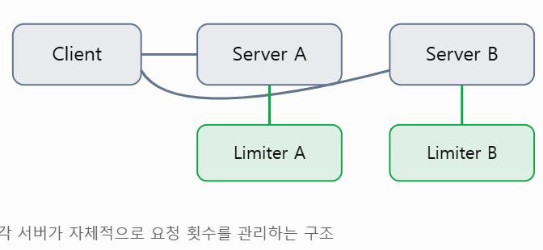
>
> 각 서버가 애플리케이션에 처리율 제한 로직을 직접 구현하는 방식 (ex| Springboot Filter나 Interceptor에서 검사)
>
> 장점: **별도의 네트워크 호출이 없어** 간단
>
> 단점: 서버마다 독립적으로 카운터 관리를 하므로 **전역 제한을 적용하기 어려움**
>
> ### **미들웨어 방식**
>
> 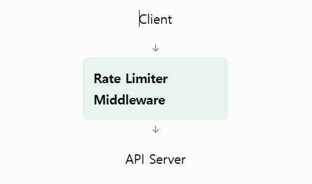
>
> 서버와 클라 사이에 요청을 검사하는 미들웨어를 배치하는 방식으로 서버 도착 전에 요청 차단 가능
>
> 장점: 애플리케이션 비즈니스로직과 분리 가능, **여러 서버에 동일한 정책 적용에 용이**
>
> 단점: 미들웨어 자체가 병목이 되거나 **장애 지점이 될 수 있어서** 미들웨어 또한 여러 인스턴스로 확장해야 함
>
> ### **API Gateway 방식 (미들웨어 방식의 일부)**
>
> 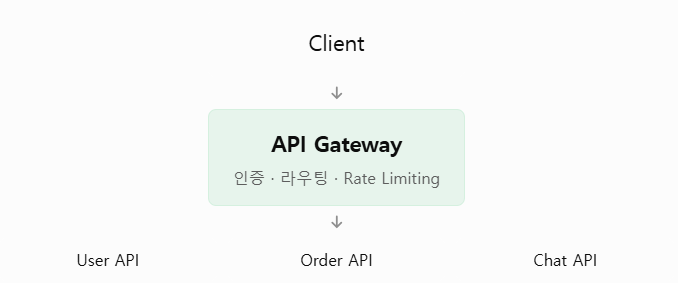
>
> API Gateway가 처리율 제한을 담당하는 구조로 AWS API Gateway, NGINX 등을 사용할 수 있음
>
> 장점: 여러 마이크로서비스에 공통 제한 정책 적용에 용이, 서버에 도달하기 전에 과도한 요청 차단 가능
>
> 단점: Gateway가 모든 요청을 처리하므로 충분한 확장성과 가용성 필요

#### **✅ 처리율 제한 장치는 어디에 둘까**

클라이언트 요청은 쉽게 위변조가 가능해 통제가 어렵기 때문에, 일반적으로 안정적인 처리율 제한을 걸기는 힘들다.

서버에 둔다면 이런식으로 둘 수 있을 것이다.

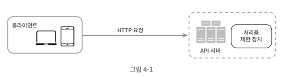

다른 방법으로는 **미들웨어**를 만들어서 API 서버로 가는 요청을 통제할 수도 있다.

보통은 API 게이트웨이에 구현한다. **API 게이트웨이는 처리율 제한, SSL 종단, 사용자 인증 등을 지원하는 완전 위탁관리형 서비스**이다.

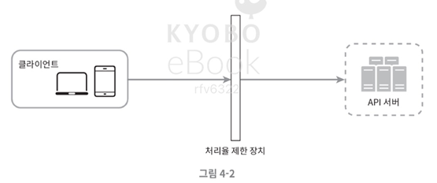

어디에 두느냐에 대한 정답은 없지만, 일반적으로 적용될 수 있는 지침은 다음과 같다.

- **현재 사용하는 기술 스택을 점검**해서 현재 기술스택이 서버 측 구현을 지원하기 **충분할 정도로 효율이 높은지** 확인하기

- 필요에 맞는 **처리율 제한 알고리즘**을 찾기
  - 다만 제3 사업자가 제공하는 게이트웨이를 사용하는 경우 선택지가 제한될 수 있음

- 이미 여러 이유로 API 게이트웨이를 설계에 포함했다면, **처리율 제한 기능 또한 게이트웨이에 포함**시켜야 할 수 있음
- 충분한 인력이 없다면 상용 API 게이트웨이를 쓰기

 

#### **✅ 처리율 제한 알고리즘 선택하기**

처리율 제한 알고리즘은 여러가지 이지만, 각기 다른 장단점을 갖는다.

**1. 토큰 버킷 알고리즘 (token bucket)**

토큰 버킷 알고리즘은 처리율 제한에 **폭넓게 이용되고 있다.** 간단하고 알고리즘에 대한 세간의 이해도가 높아 보편적으로 사용한다.

 

✔️ **동작 원리**

- **토큰 버킷**은 **지정된 용량을 갖는 컨테이너**
  - 사전에 **설정된 양만큼 토큰이 주기적으로 채워짐**
  - 다 찬 상태면 추가되지 않음
  - 토큰 공급기가 매초 2개 토큰을 추가하고, **버킷이 가득 차면 추가된 토큰은 버려짐**
- 요청은 처리될 때마다 **하나의 토큰 사용**
  - 충분한 토큰이 있으면 토큰 하나를 꺼내 요청을 시스템에 전달
  - **없으면 해당 요청이 버려짐**

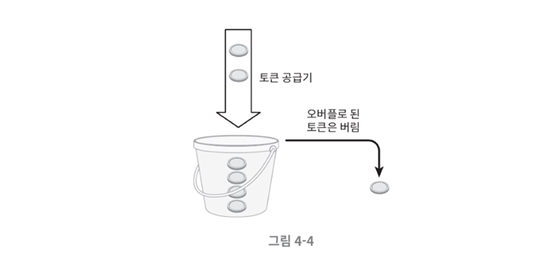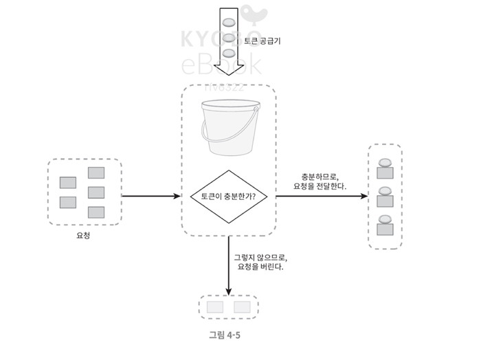

토큰 버킷 알고리즘은 **2개의 파라미터**를 받는다.

- **버킷 크기** : 버킷에 담을 수 있는 토큰 최대 수
- **토큰 공급률** : **초당 몇 개의 토큰**이 버킷에 공급되는가

 

✔️ **버킷 개수 결정**

공급 제한 규칙에 따라 달라지지만, 통상적으로는 **API 엔드포인트마다 별도의 버킷**을 둔다.

예를 들어 SNS라면, 하루에 포스팅 횟수 제한, 친구 추가 제한, 좋아요 제한 등 기능마다 제한 규칙이 다를 것이다. 이마다 각각 버킷을 두어야 한다.

만약 **IP 주소별로 제한**해야 한다면 **IP 주소마다 버킷을 할당**해야 하고, **시스템 처리율 자체를 제한**하고 싶으면 **모든 요청이 하나의 버킷을 공유**해야 한다.

 

✔️ **장단점**

**장점**

- 구현이 쉬움
- 메모리 사용 측면에서 효율적
- 짧은 시간에 집중되는 트래픽 처리 가능

**단점**

- 버킷 크기와 토큰 공급률이라는 인자를 **적절히 튜닝하는 게 어려움**

 

**2. 누출 버킷 알고리즘 (Leaky bucket)**

누출 버킷 알고리즘은 토큰 버킷과 유사하지만, **버킷에서 일정한 속도로 누출**되는 것이 특징이다. 즉, 요청 처리율이 고정되어 있다.

 

✔️ **동작 원리**

보통 **FIFO 큐**로 구현한다.

- 요청이 도착하면 큐가 찼는지 확인
  - 안 찼으면 큐에 요청 추가
  - **찼으면 새 요청을 버림**
- 지정된 시간마다 큐에서 요청을 꺼내 처리

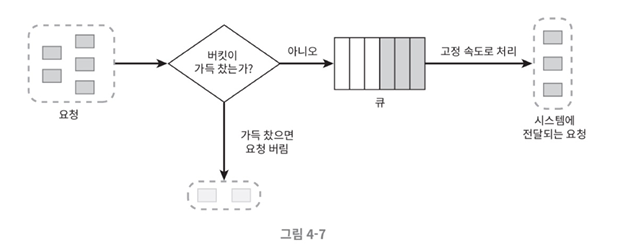

누출 버킷 알고리즘도 **두 개**의 파라미터를 받는다.

- **버킷 크기** : 큐 사이즈와 같은 값
- **처리율** : 지정된 **시간 당 몇 개의 항목을 처리할지** 지정, 보통 초 단위로 표현

 

✔️ **장단점**

**장점**

- **큐 크기가 제한**되어있어 **메모리 사용량 측면에서 효율적**
- **고정된 처리율**을 가져서 **안정적 출력**이 필요한 경우 적합

**단점**

- **단시간에 많은 트래픽이 몰리면 큐가 쌓여서 최신 요청들이 버려질 수 있음**
- 두 파라미터 적절히 튜닝하기 어려움

 

**3. 고정 윈도 카운터 알고리즘 (fixed window counter)**

✔️ **동작 원리**

- 타임라인을 고정된 간격의 윈도로 나누고, 각 **윈도마다 카운터**를 붙인다.
- 요청이 접수될 떄마다 **카운터가 증가**한다.
- 카운터 값이 임계치에 도달하면 새 요청은 새 윈도가 열릴때까지 버려진다.

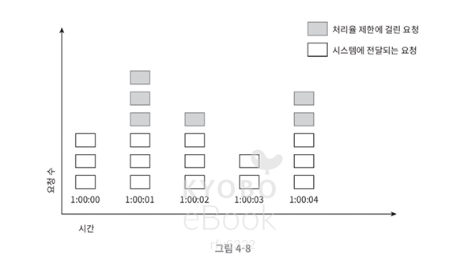

이 알고리즘의 가장 큰 문제는, **윈도의 경계 부근에 순간적으로 많은 트래픽이 집중될 경우, 윈도에 할당된 양보다 더 많은 요청이 처리**될 수 있다는 것이다.

예를 들어 1분에 5개를 처리해야 할 떄, 10:00:55~10:01:05 사이에 10개가 요청되는 경우, 1분에 5개 처리가 통과되지만 사실상 10초에 10개가 허용된 것이 된다.

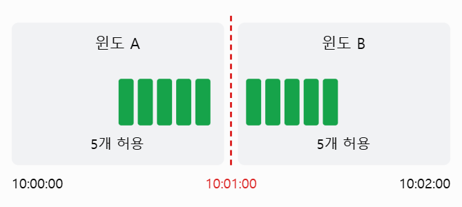

 

✔️ **장단점**

**장점**

- **메모리 효율**이 좋다
- 이해하기 쉽다
- 윈도가 닫히는 시점에 카운터를 초기화하는 방식은 특정 트래픽 패턴을 처리하기 좋다

**단점**

- **윈도 경계에 트래픽이 몰리면 순간적으로 처리율이 높아질 수 있다**

 

**4. 이동 윈도 로깅 알고리즘**

고정 윈도 카운터 알고리즘의 문제를 해결하기 위해 나온 알고리즘이다.

✔️ **동작 원리**

- 요청의 **타임스탬프를 추적**한다.
  - 타임스탬프 데이터는 보통 **redis의 sorted set 같은 캐시에 보관**한다.
- 새 요청이 오면 **만료된 타임스탬프를 제거**한다.
  - 만료 기준 : 현재 윈도의 시작 시점보다 오래된 타임스탬프
- **새 요청의 타임스탬프를 로그에 추가**한다.
- 로그 크기가 허용치보다 같거나 작으면 요청을 시스템에 전달한다
  - **그렇지 않으면 처리 거부한다.**

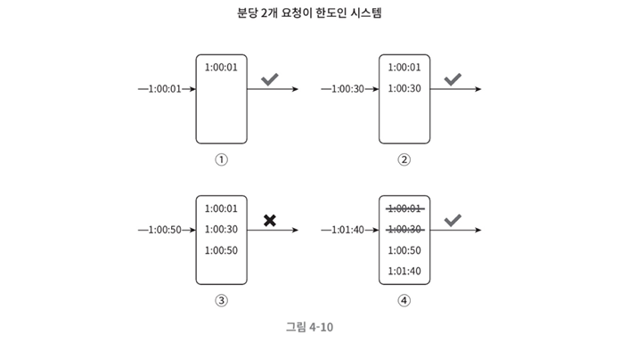

 

✔️ **장단점**

**장점**

- 처리율 제한 메커니즘이 정교하다. 허용되는 요청 수는 처리율 한도를 넘지 않는다.

**단점**

- **타임스탬프를 저장해야 하므로 메모리 사용량이 많다**

 

**5. 이동 윈도 카운터 알고리즘**

**이동 윈도 카운터 알고리즘**은 **고정 윈도 카운터 알고리즘과 이동 윈도 로깅 알고리즘을 결합**한 것이다.

✔️ **동작 원리**

처리율 제한 장치의 한도가 분당 7개이고, 이전 1분동안 5개가, 현재 1분동안 3개가 왔다고 가정해보자.

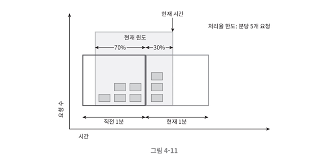

현재 1분의 30% 시점에 도착한 새 요청은 현재 윈도에 몇개의 요청이 온 것으로 보고 처리해야할까? 다음과 같이 계산한다.

> **현재 1분간의 요청수 + 직전 1분간의 요청수 \* 이동 윈도와 직전 1분이 겹치는 비율**

위 그림에서는 현재 1분동안 3개, 지난 1분은 5개, 이동윈도와 직전 1분이 겹치는 비율 70% 이므로 **3 + 5 \* 70% = 6.5개**이다. 값은 올림할수도, 내림할 수도 있다.

 

✔️ **장단점**

**장점**

- 이동 윈도 로깅 알고리즘보다 **메모리 사용량이 적다**
- 이전 시간대의 평균 처리율에 따라 현재 상태를 계산하므로 **짧은 시간에 몰리는 트래픽에도 잘 대응**한다

**단점**

- 이동 윈도 로깅 알고리즘보다 **정확도가 떨어진다**

 

### **3단계 - 상세 설계**

개략적인 설계로는 다음과 같은 사항을 알 수 없다.

- 처리율 제한 규칙은 **어떻게 만들어지고 어디에 저장되는가**
- 처리가 제한된 요청들은 **어떻게 처리되는가**

#### **처리율 제한 규칙**

처리율 제한 규칙은 보통 **설정파일 형태로 디스크에 저장**된다.

#### **처리율 한도 초과 트래픽 처리**

어떤 요청이 한도 제한에 걸리면 **HTTP 429 응답**을 보내고, 경우에 따라 나중에 처리하기 위해 **큐에 보관할 수도** 있다.

클라이언트는 **HTTP 응답 헤더**를 통해 처리율 제한에 걸리기까지 **얼마나 많은 요청을 보낼 수 있는지** 알 수 있다.

- **X-Ratelimit-Remaining** : 윈도 내 **남은 처리 가능 요청 수**
- **X-Ratelimit-Limit** : 매 윈도마다 클라이어트가 **전송할 수 있는 요청 수**
- **X-Ratelimit-Retry-After** : 한도 제한에 걸리지 않으려면 **몇 초 뒤에 다시 보내야 하는지**

아키텍처를 그려보면 다음과 같다.

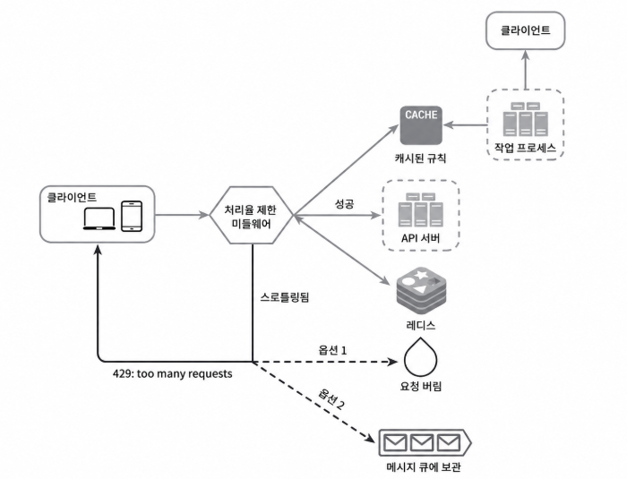

 

#### **분산 환경에서의 처리율 제한 장치 구현**

단일 서버에서 처리율 제한 장치를 구현하는 것은 어렵지 않지만, **여러 대의 서버와 병렬 스레드를 지원하도록 시스템을 확장하는 것**은 또 다른 문제가 된다. 특히 **경쟁 조건, 동기화** 문제를 풀어야한다.

**✔️ 경쟁 조건 (race condition)**

앞서 살펴본대로 처리율 제한 장치는 대략 다음과 같이 동작한다.

- redis에서 카운터의 값을 읽는다
- counter + 1이 임계치를 넘는지 본다
- 안 넘으면 redis 보관된 카운터 값을 1만큼 증가시킨다.

병행성이 심한 환경에서는 아래 그림과 같은 경쟁 조건 이슈가 발생할 수 있다.

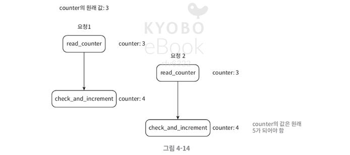

이런 문제를 해결하는 대표적인 방법은 **락을 거는 것**이다. 하지만 락은 시스템의 성능을 떨어뜨린다. 위 상황에서 락을 대체하는 해결책은 두가지가 있다.

**1. 루아 스크립트 사용**

루아 스크립트는 redis에서 제공하는 기능으로, **redis 서버에서 실행되는 스크립트**를 작성할 수 있다. 스크립트가 통쨰로 원자적으로 실행된다.

**2. Sorted Set 사용**

Sorted Set을 써도 **오래된 요청을 제거하고 현재 요청수 조회 + 새 요청 추가 작업이 동시에 실행되면 제한을 초과할 수 있다.**

따라서 Sorted Set을 사용하더라도 루아 스크립트나 Redis 트랜잭션의 WATCH 등을 활용해야 한다!

 

**✔️ 동기화 이슈**

수백만 사용자를 지원하려면 한 대의 처리율 제한 장치 서버로는 충분하지 않을 수 있다. 그래서 **여러 대를 두면 동기화가 필요**해진다.

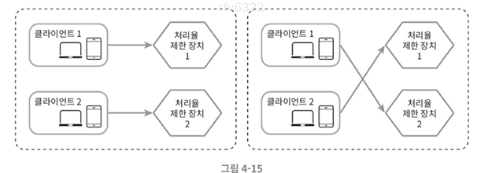

고정 세션을 쓰면 확장성에 좋지 않기 때문에 Redis 같은 **중앙 집중형 데이터 저장소**를 쓰는 게 좋다.

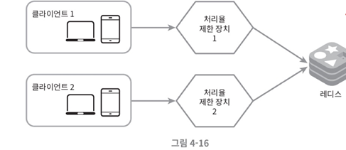

> 결국은 이 저장소도 여러 대가 필요해질 수 있고, 확장은 1장에서 배운대로 replica 혹은 샤딩을 하면 될 거 같다.

 

**✔️ 성능 최적화**

지금까지의 설계는 두 가지 지점에서 개선할 수 있다.

**1. 여러 데이터센터를 지원하는 건 처리율 제한 장치에 매우 중요하다**

데이터센터에서 멀리 떨어진 사용자를 지원하려다 보면 지연 시간이 증가할 수밖에 없다.

**2. 데이터를 동기화 할 때 최종 일관성 모델을 사용하자**

6장에서 나온다.

 

**✔️ 모니터링**

처리율 제한 장치가 효과적으로 동작하는지 보려면 모니터링을 해야 한다.

모니터링을 하면서 맞는 알고리즘으로 변경하는 것도 좋다.
