# 안정 해시 설계

수평적 규모 확장성을 달성하기 위해서는 **요청을 서버에 균등하게 나누는 것**이 중요하다. 이를 위해 사용하는 기술이 바로 **안정 해시**이다.

## **안정해시는 왜 필요할까 - 해시 키 재배치 문제**

N개의 캐시서버가 있을때, 이 서버들에 부하를 균등하게 나누는 보편적인 방법은 아래 해시 함수를 사용하는 것이다.

> serverIdx = hashKey % N (N은 서버 개수)

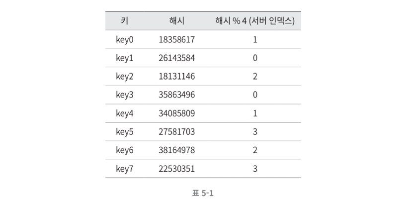

이 방법은 **서버 풀의 크기가 고정**되어있거나, **데이터 분포가 균등**할 때 잘 동작한다.

하지만 **서버가 추가되거나, 기존 서버가 삭제되면 값이 변해 문제**가 생긴다. 만약 1번 서버가 죽으면 대부분의 클라이언트는 데이터가 없는 엉뚱한 서버에 접속하게 된다.

이 문제를 안정적으로 해결하는 기술이 **안정 해시**이다.

 

## **안정 해시 (Consistent Hash)**

안정 해시는 해시 테이블 크기가 조정될 때 평균적으로 오직 **k/n개의 키만 재배치**하는 해시 기술이다. 여기서 **k는 키의 개수, n은 슬롯의 개수**이다.

앞서 배운 전통 해시 테이블은 슬롯 수가 바뀌면 대부분의 키를 재배치 해야했다.

 

### **해시 공간과 해시 링**

예시를 통해 안정 해시의 동작원리를 알아보자.

**전제**

- 해시 함수 f로는 SHA-1을 사용한다
  - **SHA-1의 해시 공간 범위는 0부터 2^160-1까지**로 알려져있다.
- 함수의 출력값 범위는 x0, x1, ..., xn 과 같다

따라서 x0 = 0, xn = 2^160 - 1이고, 나머지 x1 ~ xn - 1은 그 사이값을 갖는다.

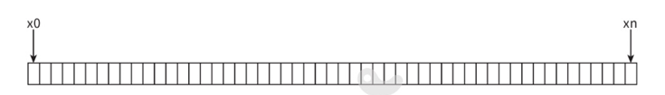

이 공간의 양쪽을 구부려 접으면 아래같은 **해시 링(hash ring)** 이 만들어진다.

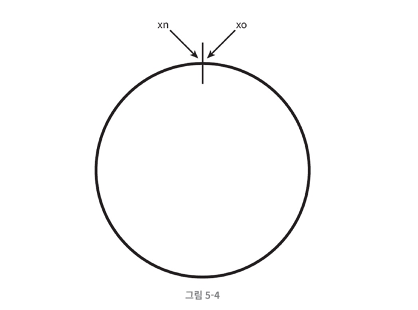

 

### **해시 서버**

해시 함수 f를 사용하면 서버 IP나 이름을 이 링 위 어떤 위치에 대응시킬 수 있다.

아래 그림으 4개의 서버를 링 위에 배치한 결과이다.

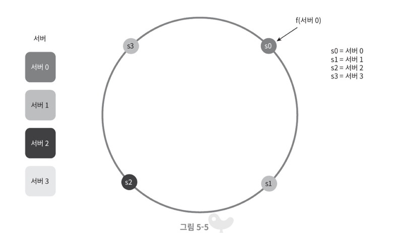

 

### **해시 키**

참고로 이 키는 나머지 연산을 사용하고 있지 않다.

아래 그림처럼 캐시할 키 또한 링 위에 배치할 수 있다.

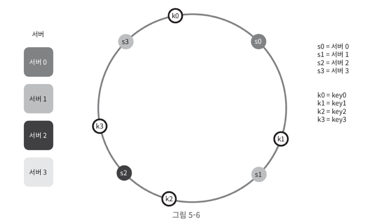

 

### **서버 조회**

어떤 키가 저장되는 서버는 **해당 키의 위치로부터 시계방향으로 링을 탐색하면서 처음 만나는 서버**가 된다.

아래 그림에서 key0은 서버0에 저장되고, key1은 서버1에 저장된다.

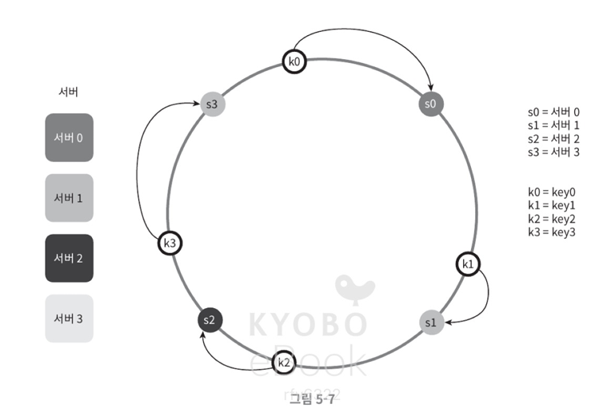

 

### **서버 추가**

방금 설명한 내용에 따르면, 서버를 추가하더라도 키 가운데 일부만 재배치하면 된다.

아래 그림에서 서버4가 추가되어도 key0만 재배치하면 됨을 알 수 있다.

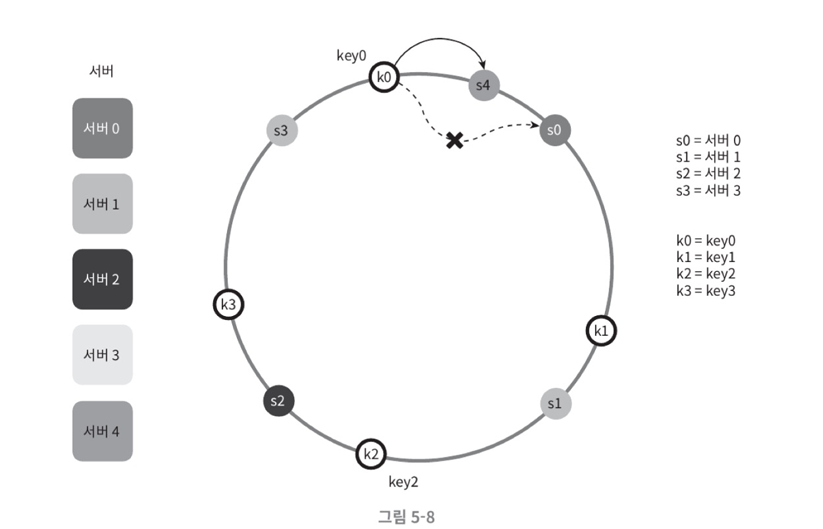

 

### **서버 제거**

서버가 제거되어도 키의 일부만 재배치하면 된다.

아래 그림에서 서버 1이 제거되었을 때, key1만 재배치됨을 알 수 있다.

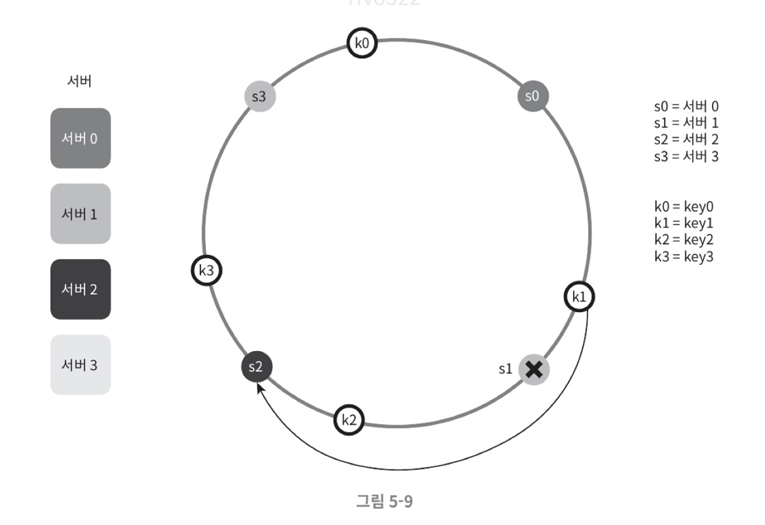

 

### **기본 구현법의 두 가지 문제**

안정 해시 알고리즘은 MIT에서 처음 제안되었다. 기본 절차는 다음과 같다.

**1. 서버와 키를 균등 분포 해시 함수를 이용해 해시 링에 배치**

**2. 키의 위치에서 링을 시계 방향으로 탐색하다 만나는 최초의 서버가 키가 저장될 서버**

 

#### **문제점**

첫번째 문제는 서버가 추가/삭제되는 상황을 감안하면 **파티션 크기를 균등하게 유지하는 게 불가능** 하다는 것이다.

여기서 **파티션**은 **인접한 서버 사이의 해시공간**이다. 어떤 서버는 작은 해시공간을 할당받고, 어떤 서버는 굉장히 큰 해시공간을 할당받는 상황이 생길 수 있다.

아래 그림을 보면 S1이 삭제되는 경우 S2의 파티션이 다른 파티션보다 2배 가까이 커진다.

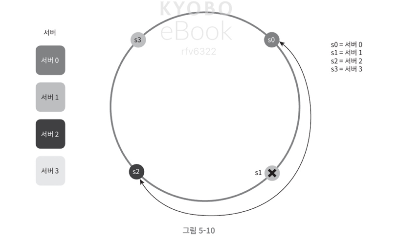

두번째 문제는 **키의 균등 분포를 달성하기 어렵다**는 것이다.

아래 그림과 같은 상황인 경우, 서버 1과 서버 3은 아무 데이터도 갖지 않지만, 서버 2는 많은 데이터를 갖는다.

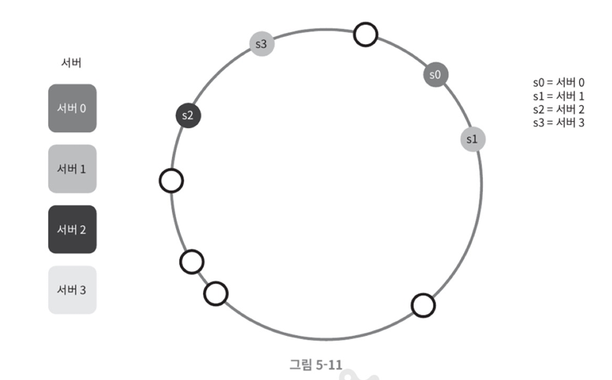

이 문제를 해결하기 위해 **가상 노드 또는 복제** 라고 불리는 기법이 제안됐다.

 

### **가상 노드 (Virtual Node)**

**가상 노드**란 **실제 노드 또는 서버를 가리키는 노드**로, **하나의 서버는 링 위에 여러 개의 가상 노드를 가질 수 있다.**

아래 그림에서 서버0과 서버1은 3개의 가상 노드를 갖는다. **서버 0을 하나만 쓰지 않고 s0_0, s0_1, s0_2 3개의 가상 노드를 사용**한 것이다.

각 서버는 하나가 아닌 **여러 파티션을 관리**하게 된다.

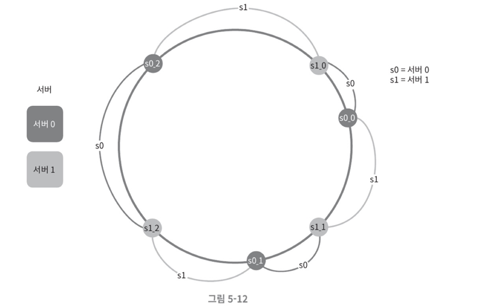

**가상 노드의 개수를 늘리면 키의 분포는 점점 더 균등**해진다. **표준편차가 작아**져 데이터가 고르게 분포되기 때문이다.

100~200개의 가상노드를 사용하면 표준편차는 평균 5~10%가 되고, 노드가 많아질수록 표준편차는 작아진다.

다만 가상 노드가 많아지면 **가상 노드 데이터를 저장할 공간이 더 많이 필요**해져 시스템 요구사항에 맞게 개수를 조절하는 게 중요하다.

 

### **재배치할 키 결정**

서버가 추가되거나 제거되면 데이터 일부는 재배치 해야한다. 어느 범위 키들이 재배치 되어야 할까?

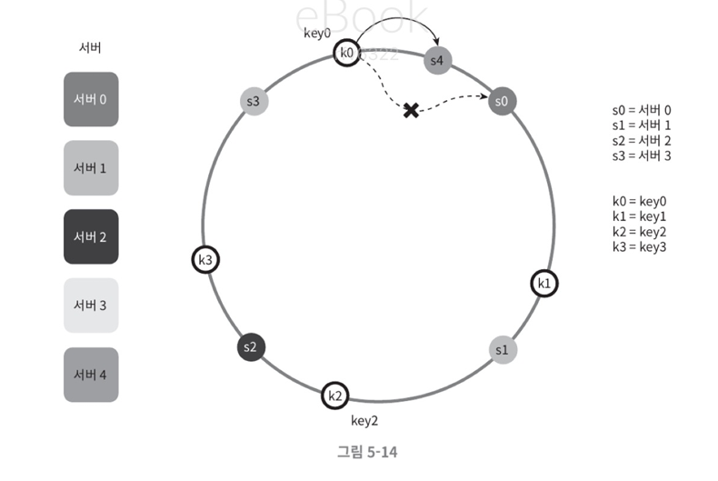

이 그림처럼 서버 4가 추가됐다고 가정해보면, 영향범위는 **S4부터 그 반시계 방향에 있는 S3까지**이다.
