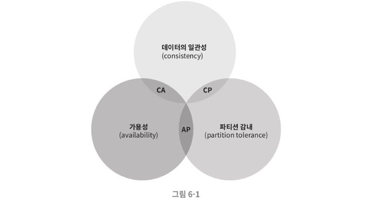
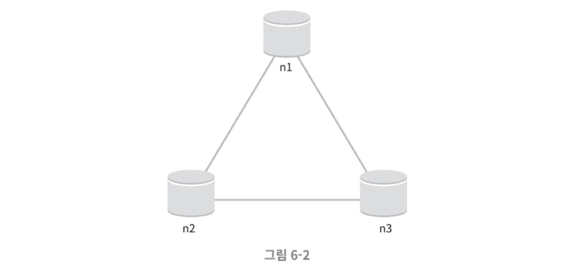
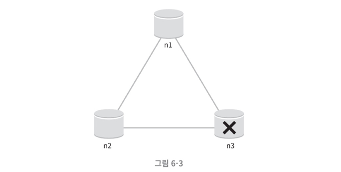
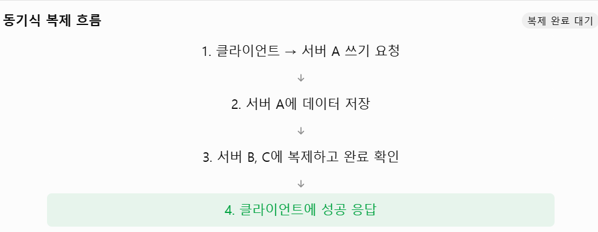
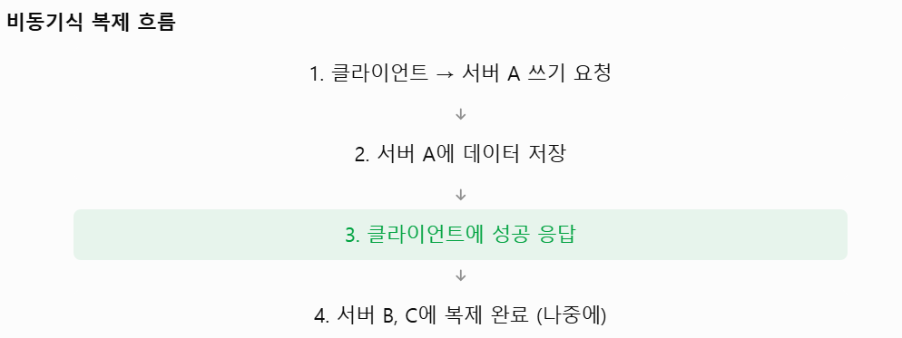
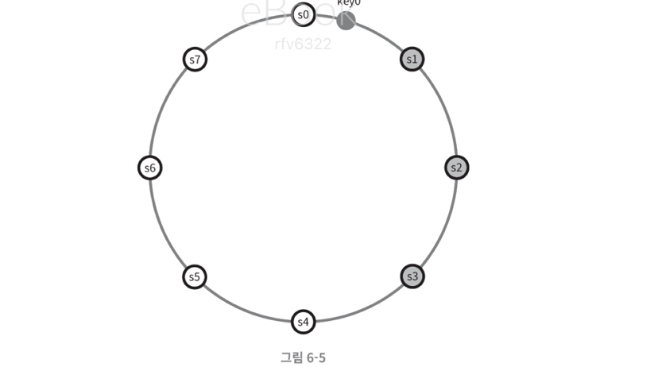
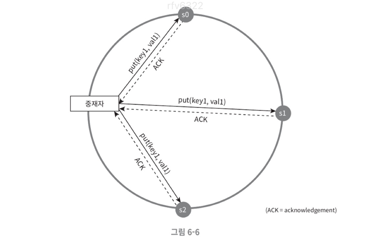

# 키-값 저장소 설계

**키-값 저장소**는 키-값 데이터베이스라고도 불리는 **비 관계형 데이터베이스**이다.

**키(key)는 고유식별자**여야 하고, 유일한 값이어야 한다. 키를 통해서만 키에 달린 값에 접근할 수 있다. 키와 값 사이의 연결관계를 **키-값 쌍(pair)** 이라고 칭한다. 참고로 키는 일반 텍스트일수도 있고 해시값일 수도 있지만, **성능상의 이유로 짧을수록 좋다.**

> 일반 텍스트 키 : "last_logged_in_at"
>
> 해시값 키 : "a3f1c2e4b5d6"

키-값 쌍에서 **값은 문자열일 수도, 리스트일 수도, 객체일 수도** 있다. 값으로 무엇이 오던 상관없다.

put과 get을 지원하는 저장소를 설계해보자.

<br>

## **문제 이해 및 설계 범위 확정**

완벽한 설계는 없다. **읽기,쓰기,메모리 사용량 사이 균형**을 찾고 데이터의 **일관성과 가용성** 사이에서 잘 결정하면 된다.

### **요구사항**

- 키-값 쌍의 크기는 10KB 이하이다
- 큰 데이터를 저장할 수 있어야 한다
- 높은 가용성을 제공해야 한다
- 높은 규모 확장성을 제공해야 한다
  - 자동으로 트래픽에 따라 서버 증설/삭제 필요
- 데이터 일관성 수준은 조정이 가능해야 한다
- 응답 지연시간이 짧아야 한다

<br>

## **단일 서버 키-값 저장소**

서버 한 대만 사용하는 키-값 저장소를 설계하는 건 쉽다. 가장 직관적인 방법은 **키-값 쌍 전부를 메모리에 해시 테이블로 저장**하는 것이다.

하지만 이 방법은 모든 데이터를 메모리에 두는 것이 불가능할 수 있다는 약점이 있다. 개선방법은 다음과 같다.

- 데이터 압축
- 자주 쓰는 데이터만 메모리에 두기

이렇게 해도 서버 한 대로 부족한 때가 온다. 많은 데이터를 저장하려면 **분산 키-값 저장소**가 필요하다.

<br>

## **분산 키-값 저장소**

분산 키-값 저장소는 **분산 해시 테이블**이라고도 한다. 설계에 들어가기 전에 **CAP 정리**를 이해해야 한다.

### **CAP 정리**

CAP 정리는 분산 시스템에서 **일관성(Consistency), 가용성(Availability), 파티션 허용성(Partition tolerance)** 중 두 가지를 만족시킬 수 있다는 이론이다. 세 가지를 모두 만족시키는 건 불가능하다.

#### **1. 일관성 (Consistency)**

분산 시스템에 접속하는 모든 클라이언트는 어떤 노드에 접속했느냐에 관계없이 **언제나 같은 데이터**를 봐야 한다.

#### **2. 가용성 (Availability)**

분산 시스템에 접속하는 모든 클라이언트는 일부 노드에 장애가 발생하더라도 **항상 응답을 받을 수 있어야 한다.**

#### **3. 파티션 허용성/감내 (Partition tolerance)**

**파티션**은 **두 노드 사이에 통신 장애가 발생**했음을 의미한다.

즉 네트워크에 **파티션이 생기더라도 시스템은 계속 동작**해야 한다는 뜻이다.

위 세 가지 중 두 가지만을 충족할 수 있다는 게 CAP 이론이다.



#### **CP 시스템**

CP 시스템은 **일관성과 파티션 허용성**을 만족하는 시스템이다. 가용성을 희생한다.

#### **AP 시스템**

AP 시스템은 **가용성과 파티션 허용성**을 만족하는 시스템이다. 일관성을 희생한다.

<br>

네트워크 장애는 분산 환경의 특성상 피할 수 없는 일이므로, **파티션문제를 감내할 수 있게 설계**되어야 한다. 따라서 CA 시스템은 존재하지 않는다.

예시를 통해 이해해보자

<br>

#### **이상적 상태**

이상적인 환경이면 네트워크가 파티션되는 상황은 절대 일어나지 않을 것이다. n1에 기록된 데이터는 n2, n3에 복제되고 데이터일관성과 가용성도 만족한다.



#### **실세계의 분산 시스템**

분산 시스템은 파티션 문제를 피할 수 없다. 파티션 문제가 발생하면 일관성과 가용성 사이에서 하나를 선택해야 한다.

아래 그림은 n3에 장애가 발생해 n2, n1과 통신할 수 없는 상황이다. **n1, n2에 기록한 데이터는 n3에 전달되지 않고**, n3에 기록되었으나 **n1, n2에 전달되지 않은 데이터가 있다면 n1, n2는 오래된 사본**을 갖고있을 것이다.



**✔️ 일관성을 선택한다면? (CP 시스템)**

데이터 불일치 문제를 피하기 위해 n1과 n2에 대한 **쓰기 연산을 중단**시켜야 한다. 그렇게 되면 **가용성이 꺠진다.**

은행권 시스템은 보통 최신 정보가 중요하기 때문에 데이터 일관성을 챙긴다.

**✔️ 가용성을 선택한다면? (AP 시스템)**

오래된 데이터를 반환할 위험이 있더라도 계속 읽기 연산을 허용해야한다. 이후 파티션 문제가 해결되면 새 데이터를 n3에 전송할 것이다.

만드려는 서비스의 요구사항에 맞게 CAP 정리를 적용해야 한다!

<br>

### **시스템 컴포넌트**

키-값 저장소 구현에 사용될 핵심 컴포넌트 및 기술은 아래와 같다.

- 데이터 파티션
- 데이터 다중화(replication)
- 일관성(consistency)
- 일관성 불일치 해소(inconsistency resolution)
- 장에 처리
- 시스템 아키텍처 다이어그램
- 쓰기 경로(write path)
- 읽기 경로(read path)

#### **1. 데이터 파티션**

대규모 애플리케이션은 전체 데이털르 한 대의 서버에 넣는게 불가능하다. 데이터 파티션은 **데이터를 여러 서버에 나누어 저장**하는 것을 의미한다.

데이터를 파티션 단위로 나눌 때 다음 문제를 중요하게 생각해봐야 한다.

- 데이터를 **여러 서버에 고르게 분산**할 수 있나
- 노드가 추가되거나 삭제될 때 **데이터의 이동을 최소화** 할 수 있나

요구사항이 익숙하다. 5장에서 공부했던 **안정해시를 사용**하는 게 적합할 것이다.

안정 해시를 사용해 데이털르 파티션하면 다음과 같은 장점이 있다.

- 규모 확장 자동화 (automatic scailing)
  - 시스템 부하에 따라 서버가 자동을 추가/삭제 되도록 할 수 있다
- 다양성
  - 각 서버의 용량에 맞게 가상 노드의 수를 조정할 수 있다
  - 고성능 서버는 **가상노드 수를 늘려서 더 많은 키를 담당하도록** 할 수 있다

#### **2. 데이터 다중화**

높은 **가용성과 안정성**을 확보하려면 데이터를 N개 서버에 **비동기적으로 다중화**할 필요가 있다.

> 다중화는 동기적, 비동기적이 있다.
>
> #### **동기식 복제**
>
> 복제를 기다려야해서 응답속도가 느릴 수 있다
>
> 
>
> #### **비동기식 복제**
>
> 복제를 기다리지 않아 응답속도는 빠르지만 유실 가능성이 있다
>
> 

여기서 N은 튜닝 가능한 값이고, N개 서버를 선정하는 방법은 다음과 같다.

1. 어떤 키를 해시 링 위에 배치
2. 그 지점으로부터 시계 방향으로 링을 **순회하면서 만나는 첫 N개 서버**에 데이터 사본을 보관



아래 그림에서는 key0이 서버 3개인 s1, s2, s3에 저장된다.

다만 가상 노드 특성상 **물리 서버 개수가 N보다 작아**질 수 있다. 이 문제를 피하려면 노드를 선택할 때 **같은 물리 서버를 중복 선택하지 않도록** 해야한다. 같은 데이터 센터에 속한 노드는 정전, 네트워크 이슈 등의 문제를 동시에 겪을 수 있어 안정성이 떨어진다.

#### **3. 데이터 일관성**

여러 노드에 다중화된 데이터는 적절히 동기화가 되어야 한다. 정족수 합의
(Quorum consensus) 프로토콜을 사용하면 읽기/쓰기 연산 모두에 일관성을 보장할 수 있다.

> **🔗 정족수 합의 프로토콜**
>
> 정족수 합의 프로토콜은 분산 시스템에서 데이터를 **여러 서버에 복제할 떄**, **몇 개의 서버가 읽기/쓰기 작업에 참여해야 성공으로 인정할지** 정하는 방식이다.
>
> 만약 3개의 서버가 있고, 동일 데이터를 복제한다 했을 때 아래같은 상황일 수 있다.
> A: 성공 / B: 성공 / C: 실패
>
> 이때 시스템은 클라이언트에 성공을 응답해야 할까 실패를 응답해야 할까?
>
> 모든 서버에 쓰기가 완료되어야 성공이라고 판단하면, 서버 한 대만 고장 나도 쓰기가 불가능해진다. 반대로 서버 한 대만 저장하고 성공이라 판단하면 나머지 서버에는 이전 데이터가 남을 수 있다.
>
> 그래서 N, W, R의 관계가 중요해진다.

- N = 사본 개수
- W = 쓰기 연산에 대한 정족수
  - 쓰기 연산이 성공한 것으로 간주되려면 적어도 W개의 서버로부터 성공응답 받아야함
- R = 읽기 연산에 대한 정족수
  - 읽기 연산이 성공한 것으로 간주되려면 적어도 R개의 서버로부터 성공응답 받아야함

아래 그림은 N = 3인 경우에 대한 것이다.



W = 1은 성공 여부를 판단하는 중재자가 **최소 1대의 서버로부터 쓰기 성공 응답을 받아야 한다**는 의미이다. 만약 S1에서 성공 응답을 받았다면 S0, S2로부터 응답을 기다리지 않아도 된다.

이때 중재자는 클라이언트와 노드 사이에서 **프록시 역할**을 하여 적절한 노드에 요청을 전달하고 결과를 모아서 응답해준다.

**✔️ W, R, N값 정하기**

이 값들을 정하는 것은 응답 지연과 데이터 일관성 사이의 중간점을 찾는 과정이다.

W와 R이 1인경우, 응답 속도는 빠를 것이다. 1보다 큰 경우에는 시스템의 데이터 일관성 수준은 향상되지만 응답속도는 느려질 것이다.

**W + R > N 인 경우 강한 일관성이 보장**된다. **일관성을 보증할 최신 데이터를 가진 노드가 최소 하나는 겹치기** 떄문이다.

요구되는 일관성에 따라 W, R, N을 조정하면 된다.

```
- R = 1, W = N -> 빠른 읽기 연산에 최적화
- W = 1, R = N -> 빠른 쓰기 연산에 최적화
- W + R > N -> 강한 일관성 보장
- W + R <= N -> 강한 일관성 보장 X
```
