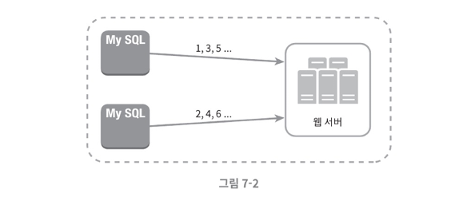
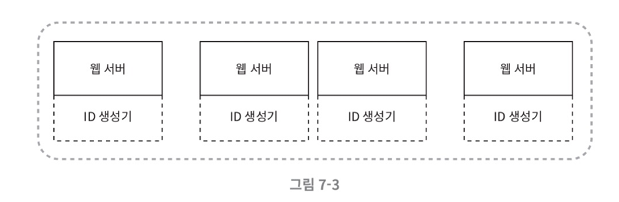
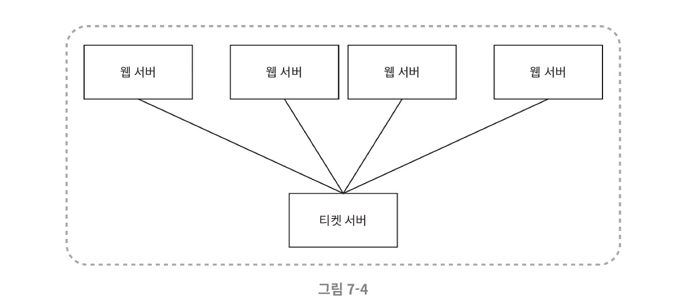
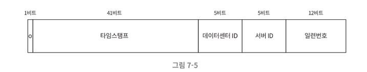

# 분산 시스템을 위한 유일 ID 생성기 설계

유일 ID를 생성할 때, 주로 auto_increment를 사용해왔다. 하지만 분산 환경에서는 서버가 여러대면 ID = 1인 데이터가 여러개가 되므로 이 접근법이 통하지 않는다.

DB 서버 한 대로 요구를 감당할 수 없고, 여러 DB 서버를 쓰는 경우 지연 시간을 낮추기도 무척 힘들다.

## **유일성이 보장되는 ID 만들기**

분산 시스템에서 유일성이 보장되는 ID를 만드는 방법은 여러가지이다.

- 다중 마스터 복제 (multi-master replication)
- UUID (Universally Unique Identifier)
- 티켓 서버
- 트위터 스노플레이크 접근법

하나씩 알아보자

### **다중 마스터 복제**

다중마스터 복제는 아래와 같은 구성을 갖는다.

이 접근법은 데이터베이스의 **auto_increment 기능을 활용**하는 것이다 다만, 다음 ID는 1만큼 증가시키는게 아니라 **k만큼 증가**시킨다. (k는 현재 사용중인 **DB 서버 수**)

이렇게하면 규모 확장성 문제를 어느정도 해결할 수 있는데, DB 수를 늘리면 초당 생산 가능 ID 수도 늘릴 수 있기 떄문이다.

단점은 **여러 데이터 센터에 걸쳐 규모를 늘리기 어렵**고, ID의 유일성은 보장되나 그 값이 **시간 흐름에 맞추어 커지도록 보장할 수는 없다.** 서버를 추가하거나 삭제할 때도 잘 동작되도록 하기는 어렵다!

### **UUID**

UUID는 유일성이 보장되는 ID를 만드는 간단한 방법이다. UUID는 컴퓨터 시스템에 저장되는 정보를 유일하게 식별하기 위한 128비트짜리 수이다.

UUID는 충돌 가능성이 매우 낮다! 값이 **09c93e62-50b4-468d-bf8a-c07e1040bfb2** 이런 형태를 띄기 때문에 중복되긴 쉽지 않다.

UUID는 서버 간 조율 없이 독립적으로 생성이 가능하다!

**장점**

- 서버 간 조율 없이 독립적으로 생성 가능하므로 **동기화 이슈 없음**
- **규모 확장도 용이**

**단점**

- ID가 길어져서 DB에 저장할 때 공간을 많이 차지함
- 숫자가 아닌 값이 포함될 수 있음
- **ID를 시간순으로 정렬 불가**

### **티켓 서버**

티켓 서버는 **유일 ID를 생성하는 전용 서버**를 두는 방법이다.

auto_increment를 갖춘 데이터베이스 서버를 **중앙 집중형으로 하나만 사용**하는 방식이다.

**장점**

- 유일성이 보장되는, **숫자로만 구성된 ID**를 쉽게 만들 수 있음
- 구현이 쉽고 중소 규모 애플리케이션에 적합

**단점**

- **티켓 서버가 단일 장애점(SPOF)이 됨**
  - 이를 해결하고자 여러대를 준비하면 데이터 동기화 같은 문제 발생

### **트위터 스노플레이크 접근법**

만약 면접에서 숫자로만 이루어지고, 날짜 순서로 받을 수 있는 유일키를 원한다면 위 방법들로는 만족시킬 수 없다.

트위터는 스노플레이크라는 독창적인 기법을 사용한다!

우선 생성해야하는 ID의 구조를 여러 절로 분할해보자.

각 절의 쓰임새는 다음과 같다.

- **사인 비**트
  - 1비트 할당
  - 음수/양수 구분에 사용 가능
- **타임스탬프**
  - 41비트 할당
  - 기원시각 이후로 몇 밀리초 경과했는지 나타냄
- **데이터센터 ID**
  - 5비트 할당
  - 그러면 32개의 데이터 센터 지원 가능
- **서버ID**
  - 5비트 할당
  - 데이터 센터 당 32개 서버 사용 가능
- **일련번호**
  - 12비트 할당
  - 각 서버에서는 ID 생성할 때마다 이 일련번호를 1만큼 증가시킴
  - 이 값은 1 밀리초 경과할 때마다 0으로 리셋됨
