# URL 단축기 설계

시스템을 설계할 때 고전적인 문제중에 하나가 바로 tiny url 같은 URL 단축기 문제이다. 예제로 한 번 풀어보자.

## 1. 문제 이해 및 설계 범위 확정

계속해서 강조했지만, 질문을 통해 모호함을 줄이는 게 중요하다.

단축 URL을 제공해야 하고, 요구사항은 아래와 같다고 가정하자.

1. URL 단축 : 주어진 긴 URL을 훨씬 짧게 줄인다
2. URL 리디렉션 : 축약된 URL로 HTTP 요청이 오면 원래 URL로 안내
3. 높은 가용성과 규모확장성, 장애 감내 요구

**개략적 추정**

- 쓰기연산 : 매일 1억개의 단축 URL 생성
  - 초당 쓰기연산 : **1억 / 24 / 3600 = 1160**
- 읽기연산 : 읽기:쓰기 비율이 10:1이라 하면 읽기 연산은 11,600회 발생
- 10년간 운영한다면 **1억 * 365 * 10 = 3650억개의 레코드**를 보관해야함
  - 즉 10년간 필요한 저장공간은 **3650억 \* 100 바이트 = 36.5TB**

## 2. 개략적 설계안 제시 및 동의구하기

API 엔드포인트와 URL 리디렉션, URL 단축 플로우에 대해 살펴보자.

### **API 엔드포인트**

클라이언트는 서버가 제공하는 API 엔드포인트로 통신한다. 우리는 이 엔드포인트를 보통 RESTful로 설계한다.

URL 단축기는 기본적으로 두 개의 엔드포인트를 필요로 한다.

**1. URL 단축용 엔드포인트**

새 단축 URL을 생성하려면 이 엔드포인트에 단축할 URL을 인자로 실어서 POST 요청을 보내야 한다.

**2. URL 리디렉션용 엔드포인트**

사용자가 단축 URL을 클릭하면 이 엔드포인트로 GET 요청이 들어오고, 서버는 원래 URL로 리디렉션한다.

### **URL 리디렉션**

브라우저에 단축 URL을 입력하면 아래와 같은 일이 일어난다.

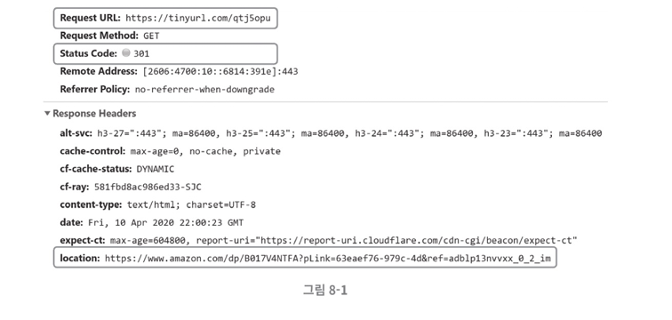

단축 URL을 받은 서버는 그 URL을 **원래 URL로 바꾸어 301 응답의 Location 헤더에 넣어 반환**한다.

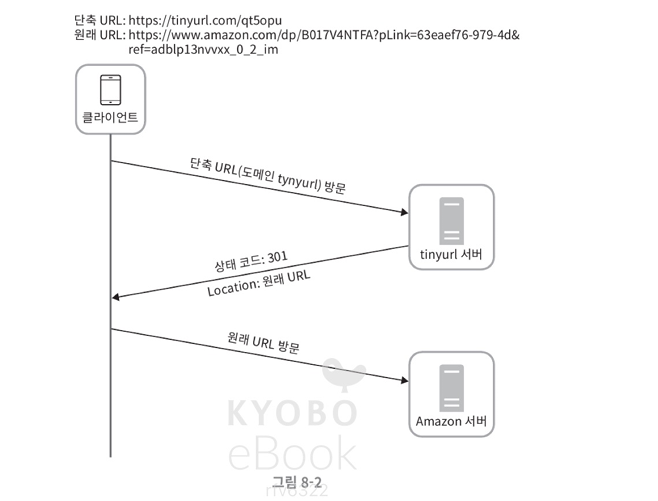

이때 301 응답과 302 응답은 차이가 있다.

- **301 Permanently Moved** : 영구적 이동
  - 해당 URL에 대한 HTTP 요청의 처리 책임이 영구적으로 Location 헤더에 반환된 URL로 이전되었다는 응답
  - 영구적으로 옮겼으므로 이를 **캐시**함
- **302 Found**
  - 주어진 URL 요청이 **일시적으로** Location 헤더가 지정하는 URL에 의해 처리되어야 한다는 응답

**서버 부하**를 줄이는 게 중요하면 **301 Permanent Moved** 가 좋지만, **트래픽 분석**이 중요할 때는 **302 Found**가 클릭 발생률 등을 추적하기 유리하다.

URL 리디렉션 구현에 가장 직관적인 방법은 **해시 테이블을 사용**하는 것이다. 단축URL, 원래URL 쌍으로 구현할 수 있다.

### **URL 단축**

단축할 때 중요한 것은 해시값으로 대응시킬 수 있는 해시함수를 찾는 일이다.

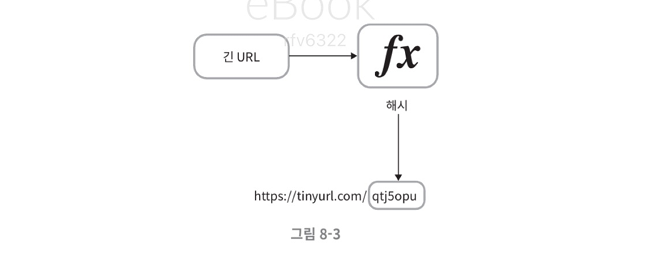

해시함수는 다음을 만족시켜야 한다.

- 입력으로 주어지는 URL이 다르면 해시값도 달라야 한다
- 계산된 해시값은 원래 입력으로 주어졌던 긴 URL로 복원될 수 있어야 한다

 

## **3. 상세 설계**

이제 데이터 모델, 해시 함수, URL 단축 및 리디렉션의 구체적 설계안을 만들어보자

### **데이터 모델**

위에서 간단하게 설계할 땐 모든것을 해시 테이블에 두었다. 초기에는 괜찮지만 실제 시스템을 쓰기에는 **메모리가 비싸기 때문**에 곤란하다.

더 나은 방법은 단축 URL, 원래 URL을 RDB에 저장하는 것이다. 메모리에 올리지 않으니 기존 문제를 해결할 수 있다.

### **해시 함수**

해시 함수는 원래 URL을 단축 URL로 변환하는 데 쓰인다.

#### **해시값 길이**

해시 함수가 계산하는 단축 URL 값을 hashValue라고 하겠다. 이는 [0-9, a-z, A-Z] 의 문자들로 구성되기 때문에 사용가능 문자 개수는 62개이다.

앞서 가정했듯이 3650억개의 URL을 만들 수 있어야 하기 때문에, 해시값 길이를 정하려면 **62^n** >= 3650억인 n의 최솟값을 찾아야 한다.

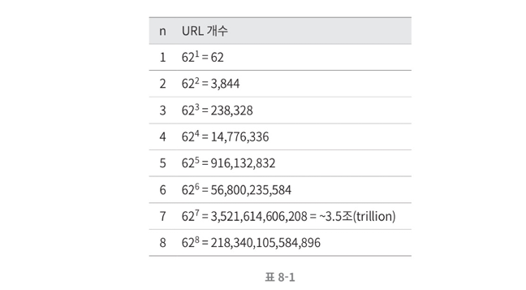

7이면 3.5조개를 만들 수 있으므로 7로 길이를 결정해도 된다.

#### **해시 함수 구현 - 1. 해시 후 충돌 해소**

긴 URL을 줄이려면 원래 URL을 7글자 문자열로 줄이는 해시함수가 필요하다. 쉬운 방법은 **CRC32, MD5, SHA-1 같은 유명한 해시 함수를 쓰는 것**이다.

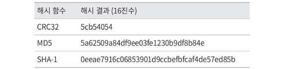

그런데 모두 7글자보다 길다! 7글자로 줄이는 방법으로는 첫 7글자만 사용하는 것인데, 그러면 충돌 확률이 높아진다.

충돌이 발생한 경우, 충돌이 해소될 떄까지 **사전에 정한 문자열을 해시값에 덧붙인**다.

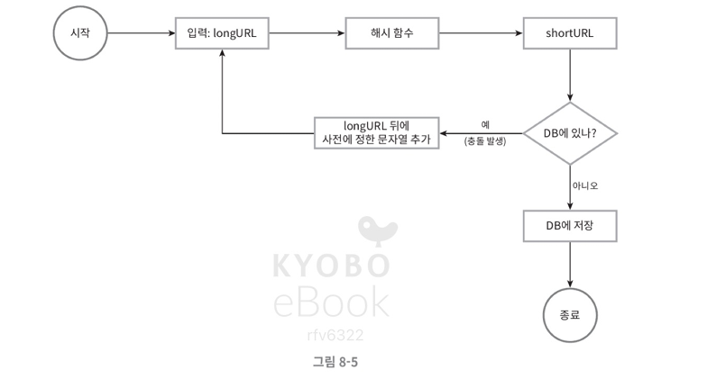

충돌은 해결할 수 있겠지만, 단축 URL을 생성할 때 한 번 이상 데이터베이스 질의를 해야해서 오버헤드가 크다. DB 대신 **블룸 필터**를 쓰면 성능을 높일 수 있다.

> **🔗 블룸 필터**
>
> 어떤 집합에 **특정 원소가 있는지 검사**할 수 있도록 하는 확률론에 기초한 공간 효율이 좋은 기술이다. **적은 메모리로 빠르게** 검사할 수 있다.
>
> 결과는 없다, 있을 수 있다 두가지이다.
>
> 동작 방식은 다음과 같다.
>
> 1. 비트 배열을 모두 0으로 초기화
> 2. 값을 추가할 때 여러 해시 함수로 위치를 계산하고, 해당 비트를 1로 변경
> 3. 값을 조회할 때 같은 위치들을 검사
>    - 하나라도 0이면 없는 값이고, 모두 1이면 있을 가능성이 있음

#### **해시 함수 구현 - 2. base-62 변환**

**진법변환**은 URL 단축기를 구현할 때 흔히 사용되는 접근법 중 하나이다. 수의 표현 방식이 **다른 두 시스템이 같은 수를 공유해야 하는 경우** 유용하다.

우리 예시의 경우 해시값에 쓸 수 있는 문자가 62개이기 때문에 62진법을 사용한다.

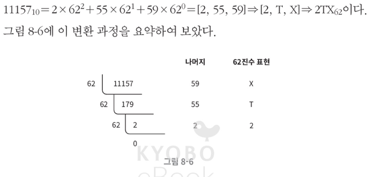

이렇게 진법변환을 사용해 단축 URL을 뽑을 수 있다.

#### **두 접근법 비교**

차이는 다음과 같다.

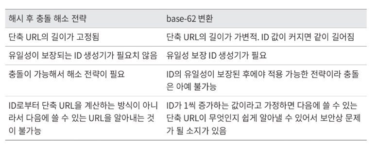

### **URL 단축기 상세 설계**

URL 단축기는 시스템의 핵심 컴포넌트이므로 그 처리 흐름이 **논리적으로는 단순**해야하고, 기능적으로는 **항상 동작**해야 한다. 다음 사진과 같은 흐름으로 처리된다.

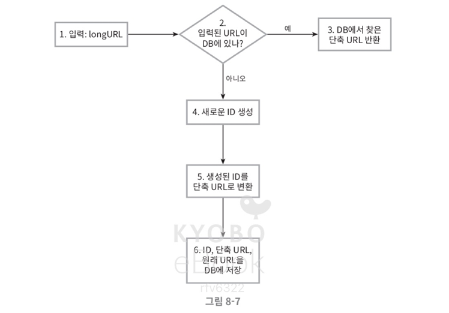

복붙가능하게 텍스트로써줘

오전 10:42

1. 입력으로 긴 URL을 받는다.
2. 데이터베이스에 해당 URL이 있는지 검사한다.
3. 데이터베이스에 있다면 해당 URL에 대한 단축 URL을 만든 적이 있는 것이다. 따라서 **데이터베이스에서 해당 단축 URL을 가져와서 클라이언트에게 반환**한다.
4. 데이터베이스에 없는 경우에는 해당 URL은 새로 접수된 것이므로 **유일한 ID를 생성**한다. 이 ID는 데이터베이스의 기본 키로 사용된다.
5. 62진법 변환을 적용, **ID를 단축 URL로** 만든다.
6. ID, 단축 URL, 원래 URL로 새 데이터베이스 레코드를 만든 후 단축 URL을 클라이언트에 전달한다.

예를 들어 아래와 같은 상황이라고 가정하자

- 입력된 URL이 https://en.wikipedia.org/wiki/Systems_design이라고 하자.
- 이 URL에 대해 ID 생성기가 반환한 ID는 2009215674938이다.
- 이 ID를 62진수로 변환하면 zn9edcu를 얻는다.
- 아래와 같은 새로운 데이터베이스 레코드를 만든다.
  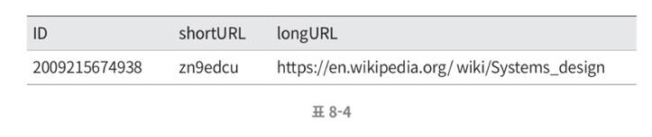

### **URL 리디렉션 상세 설계**

쓰기보다 읽기를 더 자주하는 시스템으로 가정했기 때문에, 캐시를 사용해 성능을 높일 수 있다.

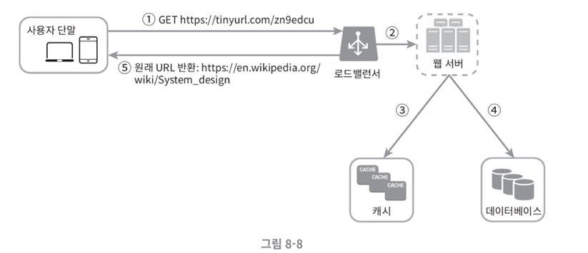
