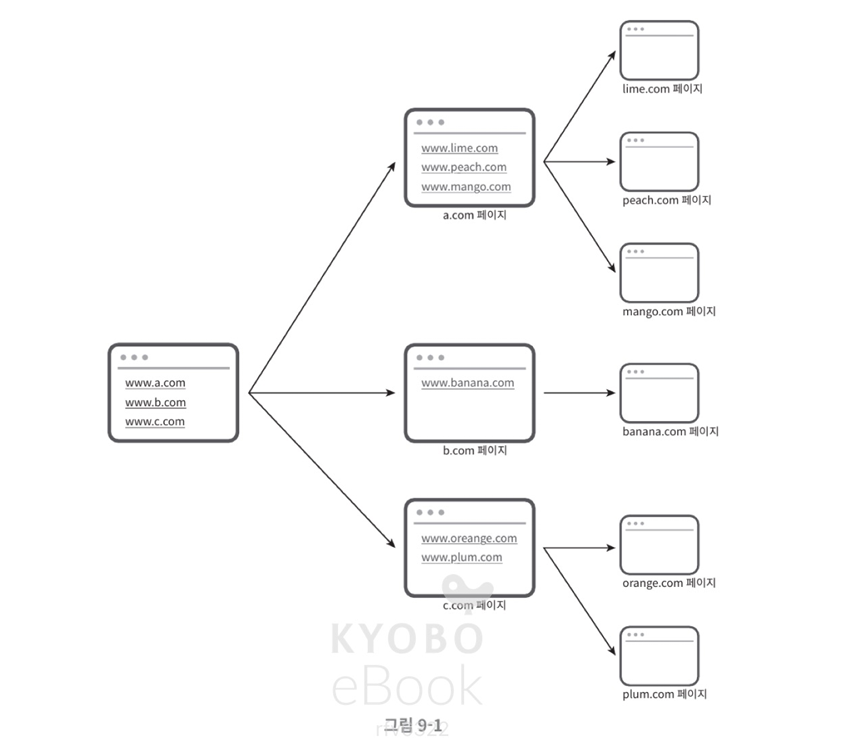
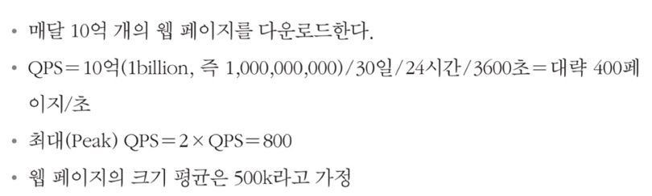

# 웹 크롤러 설계

웹 크롤러는 로봇 또는 스파이더라고 부른다. 검색 엔진에서 널리 쓰는 기술로, **웹에 새로 올라오거나 갱신된 컨텐츠를 찾아내는 것**이 주 목적이다.

웹 크롤러는 몇 개의 웹페이지에서 시작해 그 링크를 따라 나가면서 새로운 컨텐츠를 수집한다.

## 크롤러 활용

크롤러는 다양하게 이용된다.

### **검색 엔진 인덱싱 (search engine indexing)**

검색 엔진은 웹 크롤러를 이용해 **웹페이지를 수집하고, 그 내용을 분석하여 검색 결과를 제공**한다. 구글, 네이버, 다음과 같은 검색 엔진들은 웹 크롤러를 통해 웹 전체를 탐색하며, 새로운 페이지나 업데이트된 페이지를 찾아내어 인덱싱한다.

크롤러에 가장 보편적인 용례이며, 크롤러는 **웹 페이지를 모아 검색 엔진을 위한 로컬 인덱스**를 만든다.

### **웹 아카이빙 (web archiving)**

나중에 사용할 목적으로 **장기보관 하기 위해 웹에서 정보를 모으**는 절차를 말한다. 많은 국립 도서관이 크롤러를 돌려 웹사이트를 아카이빙한다.

### **웹 마이닝 (web mining)**

웹 마이닝은 웹 크롤러를 이용해 **웹에서 정보를 수집하고, 그 데이터를 분석하여 유용한 정보를 추출**하는 기술이다.

웹 마이닝을 통해 **인터넷에서 유용한 지식을 도출**해낼 수 있는 것이다.

유명 금융 기업들이 크롤러를 사용해 주주총회 자료 등을 받아 기업의 핵심 사업 방향을 알아내기도 한다.

### **웹 모니터링 (web monitoring)**

웹 모니터링은 웹 크롤러를 이용해 **웹사이트의 변화를 감시**하는 기술이다. 즉 인터넷에서 저작권이나 상표권이 침해되는 사례를 모니터링 할 수 있다.

 

웹 크롤러의 복잡도는 웹크롤러가 처리해야하는 데이터의 규모에 따라 달라진다. 따라서 우선 우리가 설계할 웹 크롤러가 담당해야하는 **데이터의 규모와 기능들을 알아야** 한다.

 

## 문제 이해 및 설계 범위 확정

웹 크롤러의 기본 알고리즘은 다음과 같다.

1. URL 집합이 입력으로 주어지면, 해당 **URL이 가리키는 모든 웹페이지를 다운로드**
2. 다운받은 **웹페이지에서 URL 추출**
3. 추출된 URL들을 **다운로드 할 URL 목록에 추가**하고 계속 반복

웹 크롤러는 사실 이렇게 단순하지 않다. 규모 확장성을 갖는 웹 크롤러를 설계하는 것은 매우 어렵다. 떄문에 설계 진행 전 요구사항을 알아내야 한다.

### 웹 크롤러의 속성

좋은 웹 크롤러가 만족시켜야 할 다음과 같은 속성에 신경쓰는것도 중요하다.

#### **규모 확장성**

웹 크롤러는 수많은 웹페이지를 다운로드하고, 그 안에서 URL을 추출해야 한다. 따라서 병행성을 활용해 **다운로드와 URL 추출을 동시에 수행**하면 효과적으로 크롤링을 할 수 있다.

#### **안정성 (robustness)**

웹은 함정이 가득하기 때문에, 잘못된 HTML, 아무반응 없는 서버, 악성 코드가 붙은 링크 등에 잘 대응할 수 있어야 한다.

#### **예절 (politeness)**

크롤러는 수집 대상 웹사이트에 짧은 시간동안 너무 많은 요청을 보내면 안된다.

#### **확장성 (extensibility)**

새 형태의 콘텐츠를 지원하기 쉬워야 한다. 예를 들어 이미지 파일도 크롤링 하고 싶다면, 이를 위해 전체 시스템을 새로 설계해야하면 안된다.

 

### **개략적 규모 추정**

위 가정으로부터 추정치를 뽑는다.

+) **10억 페이지 \* 500k = 500TB/월**이고, 5년 보관한다면 **500TB * 12 * 5 = 30PB의 저장용량**이 필요하다.
